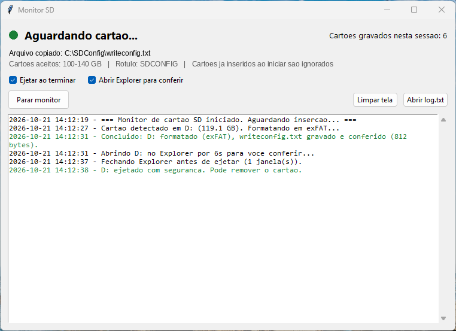

# SD Auto Format

Script em Python para Windows que prepara cartões SD em lote sem intervenção manual. Ele fica observando o leitor de cartão e, quando um cartão é inserido, faz tudo sozinho:

1. Detecta o cartão novo (só mídia removível e pronta, ignora leitor vazio).
2. Confere se o tamanho está na faixa esperada, para nunca formatar um pendrive ou HD externo por engano.
3. Formata o cartão (FAT32 até 32 GB, exFAT acima) via `Format-Volume`.
4. Copia o arquivo de configuração para a raiz do cartão.
5. Relê o arquivo e compara byte a byte com a origem antes de liberar o cartão.
6. Ejeta com segurança (mesma sequência do "Remover hardware com segurança").

Cada etapa vai para um log com data e hora.

## Por que fiz

No recondicionamento de dispositivos, cada cartão precisava ser formatado, receber um arquivo de configuração com nome exato e ser ejetado. Feito à mão, são vários cliques por cartão e é fácil esquecer um passo ou gravar no drive errado. Com o script, a pessoa só insere o cartão, espera o aviso e tira.

## Detalhes técnicos que deram trabalho

- **Leitor vazio parece cartão.** O leitor continua aparecendo como `DRIVE_REMOVABLE` mesmo sem cartão. A detecção usa `GetDriveType` e também testa se o volume responde (`disk_usage`).
- **Diálogo "Não há disco na unidade".** Ao sondar o leitor vazio, o Windows abre um diálogo modal que trava o script. Isso é evitado com `SetErrorMode`.
- **Console congelado.** Com o QuickEdit ligado, um clique na janela do terminal pausa o `print` e o script parece travado. O QuickEdit é desligado na inicialização.
- **Gravação que não chegou ao flash.** O arquivo é relido e comparado com a origem antes da ejeção, porque depois de ejetar não dá mais para conferir.
- **Ejeção que falha.** Basta o Explorer ter um handle aberto para o `FSCTL_LOCK_VOLUME` falhar. O script tenta o IOCTL (LOCK, DISMOUNT, liberar trava, EJECT) algumas vezes e, se não der, pede a ejeção ao Shell do Windows, que negocia com o Explorer.

## Interface gráfica



O `sd_gui.py` roda a mesma automação numa janela, sem precisar de terminal:

- Botão **Iniciar/Parar monitor** e indicador de status: cinza (parado), verde (aguardando cartão) e laranja (processando, não remova).
- Log ao vivo com cores: erro em vermelho, aviso em laranja e sucesso em verde.
- Contador de cartões gravados na sessão.
- Opções de ejetar ao terminar e de abrir o Explorer para conferir, que valem na hora.
- Aviso de que o arquivo de configuração não foi encontrado antes de qualquer formatação.
- Pede elevação (UAC) sozinha ao abrir e avisa se você tentar fechar no meio de uma gravação.

O monitor roda numa thread separada (com `pythoncom.CoInitialize` para o COM do Windows) e conversa com a janela por uma fila. Assim a interface não trava durante a formatação.

## Como usar

Requisitos: Windows e Python 3.9+.

```bash
pip install -r requirements.txt
```

**Com interface gráfica (recomendado):**

```bash
pythonw sd_gui.py
```

Dá para criar um atalho na Área de Trabalho apontando para esse comando. A janela pede permissão de administrador sozinha.

**Pelo terminal** (aberto como administrador):

```bash
python auto_format_sd.py
```

Antes de rodar, ajuste o bloco de configurações no topo do script:

| Variável | O que faz |
| --- | --- |
| `ARQUIVO_A_COPIAR` | Arquivo copiado para cada cartão. O nome é mantido. |
| `ROTULO_VOLUME` | Nome do volume após a formatação. |
| `TAMANHO_MIN_GB` / `TAMANHO_MAX_GB` | Faixa de tamanho aceita. Fora dela o cartão é ignorado. |
| `FS_FORCADO` | `None` escolhe sozinho; ou force `"FAT32"` / `"exFAT"`. |
| `EJETAR_AO_FINAL` | Ejeta o cartão ao terminar. |
| `ABRIR_EXPLORER` | Mostra o conteúdo do cartão por alguns segundos antes de ejetar. |

Cartões que já estavam inseridos quando o script começou não são formatados. Para processá-los, basta remover e inserir de novo.

> **Atenção:** o script apaga todo o conteúdo do cartão. Confira a faixa de tamanho antes de usar.

## Tecnologias

Python, Tkinter, threading, pywin32 (Win32 API, IOCTLs de armazenamento, COM do Shell), PowerShell e ctypes.
